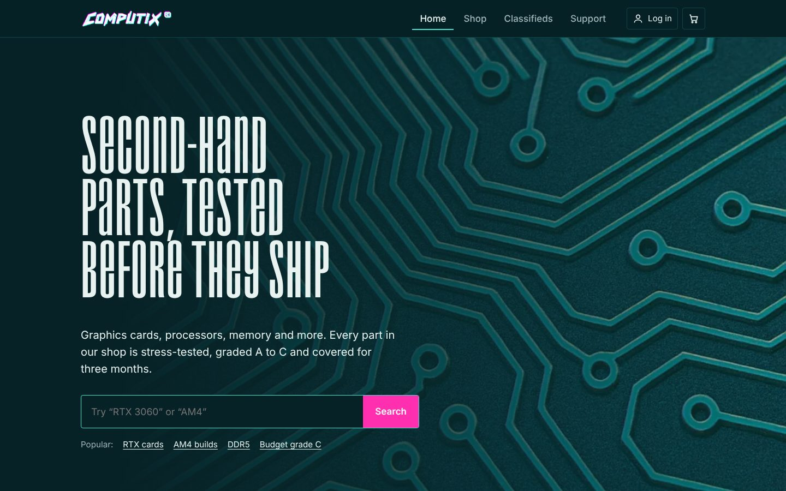
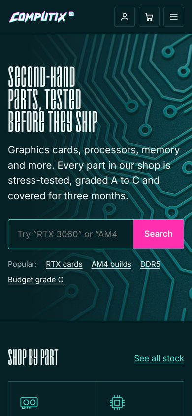
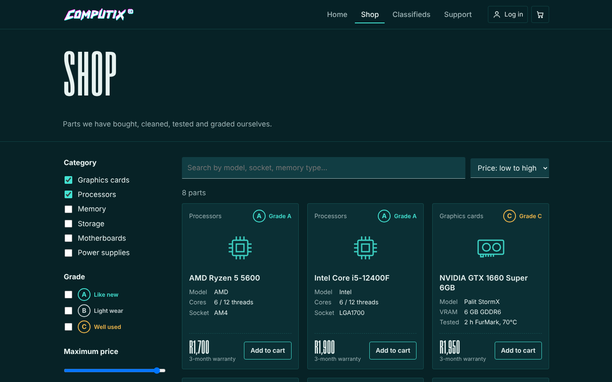

<p align="center">
  
</p>

<p align="center">
  A marketplace for tested, second-hand PC components, built with plain HTML, CSS and JavaScript.
</p>

<p align="center">
  <a href="https://YOUR-GITHUB-USERNAME.github.io/computix/"><strong>Live demo</strong></a>
</p>



## About

ComputiX started as my third-year group web development project (ITECA3-12): an online store for pre-loved computer parts in Johannesburg. The original submission was a set of static mock-up pages. I later rebuilt it into a working front-end prototype to show how I approach layout, accessibility and client-side state without a framework.

The store has two sides:

- **Shop**: parts ComputiX has bought, stress-tested and graded A, B or C, each with a 3-month warranty.
- **Classifieds**: peer-to-peer ads where builders sell parts directly to each other.

## Features

- **Search, filter and sort** the shop by keyword, category, condition grade and maximum price. Filter state is written to the URL, so a filtered view can be bookmarked or shared (for example `shop.html?cat=gpu&grade=A`).
- **Cart and checkout** in a slide-out drawer. Checking out while logged out sends you to log in and then brings you back to your cart.
- **Accounts**: register and log in with client-side validation (South African mobile number format, password rules, live strength hint, show/hide password).
- **Classifieds**: browse and filter peer ads, post your own ad through a validated modal form, and message a seller.
- **Profile**: order history and your own ads, with the option to remove an ad.
- **Support**: FAQ accordion built on native `<details>`, plus a validated contact form.
- **Responsive** from 360px phones to wide desktops, with a collapsible mobile menu and filter panel.

<p align="center">
  
  &nbsp;&nbsp;
  
</p>

## Tech and approach

| | |
|---|---|
| Languages | HTML5, CSS3 (custom properties, grid, flexbox), vanilla JavaScript (ES2017+) |
| Build step | None. Open `index.html` or serve the folder |
| Data | Demo catalogue in `assets/js/data.js`; accounts, cart, orders and ads saved in `localStorage` |
| Hosting | GitHub Pages |

Choices worth pointing out:

- **No framework, no build.** Every page is static HTML enhanced by small page-specific scripts (`assets/js/*.js`) on top of one shared module (`app.js`) for storage, auth, cart and rendering.
- **Accessibility**: semantic landmarks, skip link, labelled form controls with inline error messages tied to `aria-invalid`, keyboard-operable tabs (arrow keys) and cart drawer (Esc to close), visible focus styles, and `prefers-reduced-motion` support.
- **Safe rendering**: all user-entered text is HTML-escaped before it is inserted into the page.
- **Resilient storage**: every `localStorage` call is wrapped so the site still works when storage is blocked (for example in private browsing).
- **Performance**: background images converted from 2 MB PNGs to ~170 KB WebP, the display font converted to a 16 KB WOFF2, and no icon-font dependency (icons are inline SVG).

## Project structure

```
.
├── index.html          Home: search, categories, newest stock, grading guide
├── shop.html           Tested stock with search, filters and sorting
├── classifieds.html    Peer-to-peer ads, post-an-ad and message dialogs
├── support.html        FAQ and contact form
├── account.html        Log in / register
├── profile.html        Orders and your ads
├── 404.html
├── assets/
│   ├── css/styles.css
│   ├── js/
│   │   ├── data.js         Demo catalogue, categories, icons
│   │   ├── app.js          Shared: storage, auth, cart, header, rendering
│   │   └── home.js, shop.js, classifieds.js, account.js, profile.js, support.js
│   ├── fonts/droid-1997.woff2
│   └── img/
└── docs/               README screenshots
```

## Run it locally

No install needed. Either open `index.html` in a browser, or serve the folder:

```bash
# Python 3
python -m http.server 8000
# then visit http://localhost:8000
```

## Limitations

This is a front-end prototype. Accounts and passwords are stored in the browser (passwords are SHA-256 hashed, but this is not real authentication), and orders and messages are not sent anywhere. A production version would need a back end for:

- user authentication and sessions
- product and ad storage with image uploads
- payments (for example PayFast or Yoco) and delivery tracking
- real seller messaging

## What changed from the original coursework

| Original | Now |
|---|---|
| Home page plus empty Retail, Classifieds and Support pages | Six working pages and a 404 page |
| Broken links (`Retail`, `Support` without `.html`, missing `Settings.html`) | All internal links work |
| Registration form couldn't be reached from the menu and didn't submit | Account page with validation, login state in the header |
| Hard-coded personal details on the profile page | Profile reads the logged-in account |
| Fixed widths (`width: 160%`, `1500px`) causing horizontal scrolling | Fluid, responsive layout |
| Custom fonts referenced but never loaded | Display font loaded with `@font-face` |
| 2 MB PNG backgrounds, Font Awesome and Icons8 assets | Optimised WebP, inline SVG icons |

## Credits

- Display font: [Droid 1997](https://typodermicfonts.com/) by Ray Larabie (Typodermic Fonts), released under CC0.
- Body font: [Barlow](https://fonts.google.com/specimen/Barlow) by Jeremy Tribby, SIL Open Font License.
- Product names and prices are illustrative demo data. ComputiX is not a real store.

## Licence

Code is released under the [MIT licence](LICENSE).
